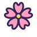
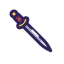
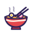
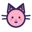
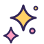

<div align="center">

&nbsp;&nbsp;&nbsp;&nbsp;&nbsp;&nbsp;&nbsp;&nbsp;

# 🌸 Anime Web Kit

**Hand-crafted anime-inspired icons & web assets for building anime-themed websites.**

`kawaii` · `zero dependencies` · `MIT license`


</div>

---

## ✨ Why Anime Web Kit?

- 🎨 **Hand-crafted SVGs** — crisp at any size, from favicons to hero graphics
- 🌈 **One consistent kawaii palette** — sakura pinks, gold sparkles, deep ink outlines
- 🪶 **Zero dependencies** — plain SVG/CSS files that drop into any stack
- 🌗 **Designed to shine on light & dark** UIs

## 📦 Icon Set · Batch 1 — Core Icons

|  |  |  |  |  |
|---|---|---|---|---|
|  |  |  |  |  |
| `sakura` | `torii-gate` | `katana` | `manga` | `anime-eye` |
|  |  |  |  |  |
| `ramen` | `onigiri` | `cat-ears` | `sparkle` | `anime-tv` |

### Usage

**As an image**
```html

```

**Inline SVG (fully themeable)** — paste the file contents into your HTML and style it with CSS:
```html
<style>
  .ak-icon { width: 32px; height: 32px; }
</style>
<span class="ak-icon"><!-- paste any icon's SVG here --></span>
```

**In Markdown / READMEs**
```markdown

```

## 🎨 Palette

| Token | Hex | Used for |
|---|---|---|
| Ink | `#322659` | outlines & details |
| Sakura | `#FF9EC0` | petals, cute accents |
| Blossom | `#F26D9C` | deeper pink accents |
| Gold | `#FFD166` | sparkles & highlights |
| Vermilion | `#E5484D` | torii, bowls, covers |
| Cream | `#FFF4E8` | rice, pages, screens |
| Lavender | `#7C5CFF` | eyes & accents |

## 🗺️ Roadmap

- [x] **Batch 1** — Core icon set (10 icons)
- [ ] **Batch 2** — Icon set II (food, festival, mecha & more)
- [ ] **Batch 3** — Kawaii UI buttons (CSS + SVG)
- [ ] **Batch 4** — Badges, dividers & section headers
- [ ] **Batch 5** — Backgrounds & seamless patterns
- [ ] **Batch 6** — Avatars & loading spinners
- [ ] **Batch 7** — Hero banners & social headers
- [ ] **Batch 8** — Starter CSS theme (design tokens)

## 📁 Structure

```
anime-web-kit/
├── icons/          # SVG icon set
│   ├── sakura.svg
│   └── ...
├── preview.html    # Visual preview of all assets
├── LICENSE
└── README.md
```

## 🤝 Contributing

Ideas, icon requests, and PRs are welcome! Open an issue with the asset type you'd love to see next.

## 📄 License

[MIT](LICENSE) — free for personal and commercial use. Attribution appreciated but not required.

---

<div align="center">
<i>Made with 💖 and too much ramen.</i>
</div>
